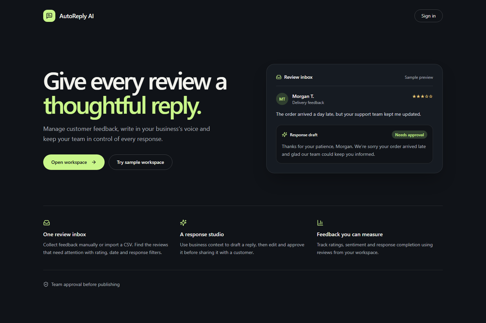
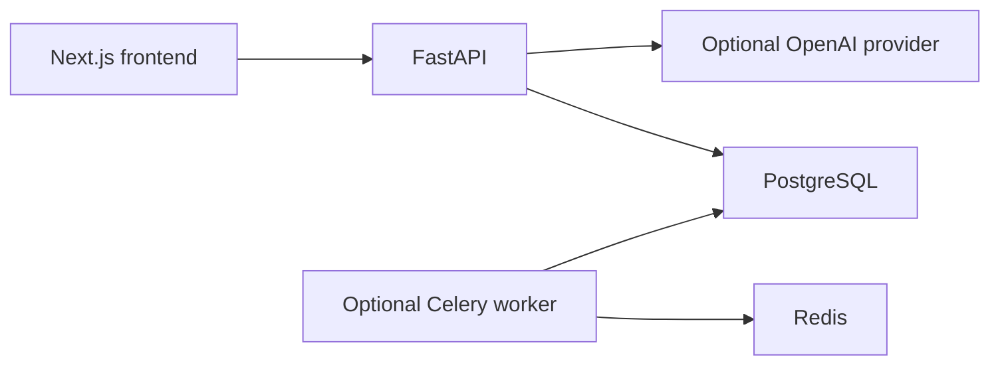

# AutoReply AI

AutoReply AI is a review operations workspace for small businesses. Collect feedback in one inbox, draft a response in the business’s voice, and approve it before sharing it with a customer. The portfolio sample uses fictional reviews and editable, prewritten drafts in the browser.



[Open the live portfolio demo](https://autoreply-review-demo.vercel.app)

## What works locally

- Manual and CSV intake with row validation and tenant-scoped duplicate detection.
- Search, rating, sentiment, response status, date filters and pagination.
- A response editor with draft saving, approval, rejection, copy and a review activity timeline.
- Business profile, response preferences and analytics computed from stored reviews.
- An optional server-side OpenAI workflow that validates reviews, classifies feedback, retrieves tenant context, generates structured drafts and records the checks. Provider failure leaves the review available for manual handling.

[Architecture](docs/ARCHITECTURE.md) · [Test evidence](docs/TEST_RESULTS.md) · [Deployment](docs/DEPLOYMENT.md) · [Portfolio views](docs/PORTFOLIO.md)



Local verification passed 120 backend tests and seven Chromium scenarios. The live demo passed separate smoke checks across desktop, tablet, and mobile.

## Local setup

Use Python 3.12, Node.js 24, and PostgreSQL. SQLite is supported for isolated local QA with the development dependencies.

1. Copy `backend/.env.example` to `backend/.env`. Set a random `SECRET_KEY` and the database URL. Generate a key with `python -c "import secrets; print(secrets.token_hex(32))"`.
2. Copy `frontend/.env.example` to `frontend/.env.local`. Set the public API URL to the API you are running.
3. Install and start the backend from `backend/`.

   ```sh
   python -m venv .venv
   # Activate the environment for your shell.
   pip install -r requirements-dev.txt
   alembic upgrade head
   python -m uvicorn app.main:app --host 127.0.0.1 --port 8000
   ```

4. Install and start the frontend from `frontend/`.

   ```sh
   npm ci
   npm run dev
   ```

Open `http://localhost:3000`. For a local account, enable `ALLOW_SIGNUPS` in the API and `NEXT_PUBLIC_ALLOW_SIGNUPS` in the frontend. Open `/demo/` for the public sample. Run `npm run build` and `npm start` to preview the static export.

## Review import

Supply a UTF-8 CSV of at most 200 reviews and 256 KB. The required columns are `rating` and `content`. Optional columns are `customer_name`, `title`, and `review_date` in ISO 8601 format. Quote fields that contain commas or newlines.

```csv
rating,content,customer_name,review_date
5,"Helpful staff, quick checkout.",Sample Reviewer,2026-11-25
```

## Data and integrations

The browser stores sign-in tokens and calls the tenant-scoped API over HTTPS on deployment. Store provider credentials and database secrets only on the API and authorized worker. Live drafting requires `AI_GENERATION_ENABLED=true`, a model key, and registration disabled. Platform adapters need independent end-to-end validation. This release supports copying approved responses for manual publishing.

This project builds on the original MIT-licensed AutoReply AI repository and its contributors. [Upstream repository](https://github.com/moldrivo/Autoreply-to-customer-agent) · [License](LICENSE)
