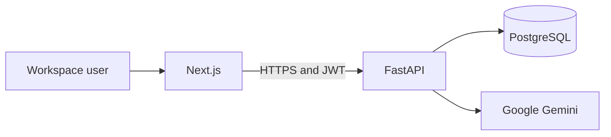

# Architecture

The Next.js frontend is statically exported and calls the tenant-scoped FastAPI service. Invite-based registration creates a private business workspace. SQLAlchemy persists reviews, responses, business settings, audit events, jobs, and usage. PostgreSQL is used in production and SQLite supports isolated QA.

## Review processing

1. Validate intake. Manual and CSV reviews use tenant-specific duplicate detection. CSV preview validates without writing. Manual intake can trigger an opt-in rule based on rating and reply language.
2. Reserve capacity using database-backed UTC budgets and a shared concurrency limit. Record the job before calling Gemini.
3. Classify the feedback using a structured Gemini result. Resolve risk, business preferences, and tenant knowledge.
4. Request a schema-validated reply from Gemini in the requested or detected language. Apply local safety checks and record audit events. Provider failures retain the review and record a retryable failed job.
5. Save the draft for human approval. The response studio supports edits and historical versions. Approved text can be copied for posting through the original channel.

The Vercel API handles drafting during the request. The legacy Celery/Redis runtime is optional and separately operated.
