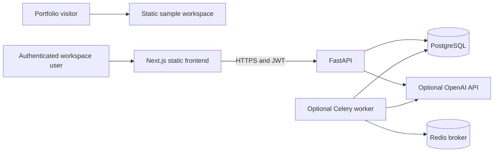

# Architecture

The web app is a static Next.js export with client-side navigation and React Query. A FastAPI dependency resolves the authenticated user and the user’s business. The API returns typed review and reply responses, including only workflow fields needed for the interface. SQLAlchemy persists reviews, the current reply, business preferences, activity events and generation usage. Alembic creates and upgrades the schema. SQLite supports isolated development and QA.

Manual, CSV and configured webhook intake write the review before users invoke drafting. Manual and CSV use a normalized content fingerprint, backed by a partial unique index on tenant, source and external ID. PostgreSQL row locks serialize draft creation and reply state transitions. Each review has one current reply. History records the review and response actions.

## Drafting

1. Load the tenant’s review and business. Initial generation reuses an existing draft.
2. Validate the review and detect language, intent, sentiment and risk.
3. Retrieve brand and knowledge context.
4. Send bounded, structured review data to the configured OpenAI model and validate the returned draft.
5. Apply safety and quality checks. Route drafts to human review and save events and usage in the same transaction.
6. Let the operator edit, approve, reject or copy the draft. A material edit returns it to approval.

Generation runs on demand from the review detail. Celery remains available for independently operated background tasks using Redis. The hosted static demo contains only fictional review data and client-side state.
